# Drone-site

<picture>
  <source media="(prefers-color-scheme: dark)" srcset="assets/hero-dark.svg">
  <source media="(prefers-color-scheme: light)" srcset="assets/hero-light.svg">
  
</picture>

A drone rental site. Customers browse the fleet, book a drone by the hour, and return it from their rental history. The cost is calculated on return as hours flown times the drone's hourly rate.

## Features

- Fleet listing with photo galleries, hourly prices and live availability
- Booking form, and a rental history looked up by email
- Returns that stamp the end time and compute the total cost
- Reviews with 1-5 star ratings per drone
- Site stats, plus an admin dashboard with 30 days of bookings and revenue

## Stack

| Layer | Tech |
|---|---|
| Frontend | Next.js 14 (App Router), TypeScript, Tailwind CSS, Framer Motion, Recharts |
| Backend | Django 4.2, Django REST Framework, gunicorn |
| Database | PostgreSQL 15 |
| Dev tooling | Docker Compose, Adminer |

## Run it

```bash
docker compose up --build
```

On start-up the backend runs migrations and loads the sample fleet from `backend/rentals/fixtures/`.

| Service | URL |
|---|---|
| Site | http://localhost:3000 |
| API | http://localhost:8000/api/ |
| Adminer (database UI) | http://localhost:8090 |

## API

| Method | Path | Purpose |
|---|---|---|
| GET | `/api/drones/` | List the fleet |
| GET | `/api/drones/<id>/availability/` | Booked and completed slots for one drone |
| POST | `/api/rentals/` | Create a booking |
| GET | `/api/rentals/history/?email=` | Rentals for one customer |
| PATCH | `/api/rentals/<id>/return/` | Return a drone and compute the cost |
| GET, POST | `/api/reviews/` | List or add reviews (`?drone=<id>` to filter) |
| GET | `/api/stats/` | Site-wide counts and ratings |
| GET | `/api/admin/stats/` | 30-day bookings and revenue (admin) |
